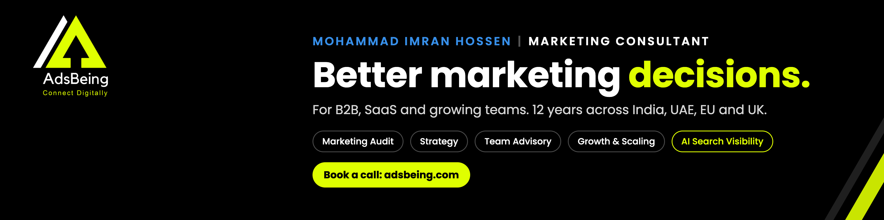
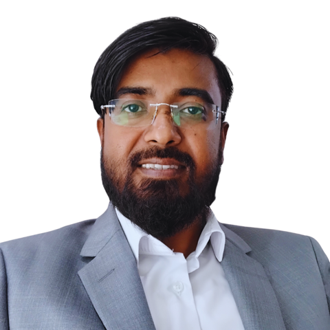
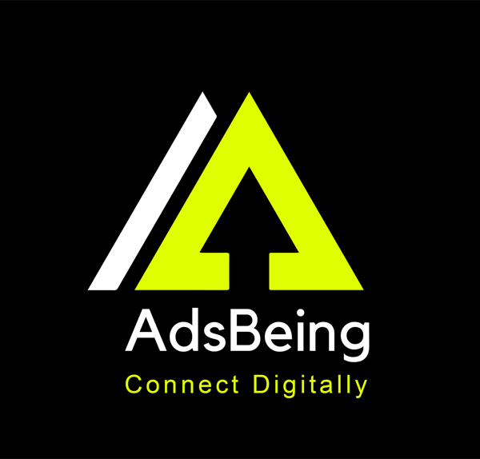

<table>
<tr>
<td width="200" align="center" valign="top">

</td>
<td valign="top">

# Hi, I'm Mohammad Imran Hossen

**Performance Marketing Manager | Google, Meta and LinkedIn Ads | AEO and AI-Driven Growth**

I help B2B and SaaS teams cut wasted ad spend, fix lead quality and get recommended inside ChatGPT, Gemini and Claude.

12 years in marketing and business: 8 in India, 4 in Dubai. Based in Bengaluru, working across India, the UAE, Europe, the UK and the USA. Founder of **AdsBeing Connect Digitally**.

*Human Before Titles.*

</td>
</tr>
</table>

---

## Results at a glance

| 61% | 15.7x | 48% | $5M+ |
|:---:|:---:|:---:|:---:|
| Google Ads spend cut ₹9.9L to ₹3.8L a month | Peak ROAS from 5.2x at takeover | CAC reduction at a hospitality brand | B2B pipeline built from zero, sole marketer |

Spacez Hospitality (Bengaluru): spend and CAC figures by Q2 2026. ROAS went 5.2x, 7.3x (Q1), 10.4x (Q2) and peaked at 15.7x in Q3 2026. 15.7x is a peak, not an average. Figures are self-reported. Client names are withheld.

---

## What I do

| | Service | Outcome |
|---|---|---|
| 1 | **Marketing Audit** | Campaigns, tracking, landing pages and lead flow reviewed. You get a ranked action plan |
| 2 | **Strategy from Scratch** | Audience, offer, channels, budget and measurement, set before you spend |
| 3 | **Team Advisory** | A senior second opinion beside your team or agency |
| 4 | **Growth and Scaling Advisory** | Lead quality and cost checked before you raise spend |
| 5 | **AI Search Visibility (AEO)** | Your brand recommended in ChatGPT, Gemini and Claude answers |
| 6 | **Paid Media Management** | Google Ads, LinkedIn Ads, Meta Ads and ChatGPT Ads |

---

## Selected work

### Spacez Hospitality and Foods, Bengaluru
*Marketing Manager, Dec 2025 to present*

- Rebuilt an under-performing Google Ads account. Removed ₹8.6 lakh (44%) of inefficient spend in Q1 2026
- Cut monthly Google Ads spend 61%, from ₹9.9 lakh to ₹3.8 lakh, while ROAS rose from 5.2x to 10.4x by Q2
- Lifted direct booking revenue 30% through 12 Google Ads campaigns, reducing dependence on OTAs
- Improved CTR from 8% to 15% with disciplined A/B testing
- Built a Reddit-supported AEO programme. Within 3 months the brand was recommended in ChatGPT, Gemini and Claude for selected Bengaluru luxury-stay queries
- Built a Claude and MCP optimisation engine and a Google Ads Script that filters irrelevant search terms. Saves about 2 to 3 hours a day
- Grew organic bookings from 10 to 20 a month through SEO and AEO: 45 blog posts, 3 Reddit accounts, 41 Google Business Profiles

### AdsBeing, Dubai, UAE and Europe (Remote)
*Performance Marketing Consultant, Jun 2025 to Nov 2025*

- 70+ B2B leads a month for a luxury fashion and sports wholesaler on a $30K monthly budget, across the UAE and 10 European markets
- Launched UAE market entry for a real estate CRM SaaS: 60+ Book-a-Demo leads a month through Google Ads

### Express Trade Financing Brokerage, Dubai
*Performance Marketing Manager, Feb 2024 to May 2025*

- Built a $5M+ high-ticket B2B pipeline from zero as the sole marketing function
- 90+ qualified leads a month on a $55K monthly budget, plus 10 to 20 organic leads
- CPA down 22%, CTR up 9%. Organic traffic grew from 100 to 3,000 sessions a month in 90 days
- Automated lead routing with Zapier and HubSpot. Built reporting in Looker Studio with GA4 and PostHog

### SkyView Technical Services, Ajman, UAE
*Digital Marketing Manager, May 2022 to Nov 2023*

- 45+ qualified leads a month and sales up 37% in six months, as a solo marketing function through Local SEO, Google Ads and Meta Ads

### TagMaxx, Tripura, India
*Co-Founder and Head of Marketing, 2014 to 2021*

- Led a 20-person team. Built distribution to 300 retail outlets and 40 institutions

---

## Toolkit

| Area | Tools |
|---|---|
| **Paid media** | Google Ads (Search, PMax, Display, YouTube, App), Meta Ads with Conversion API, LinkedIn Ads, ChatGPT Ads |
| **Measurement** | GA4 with server-side tracking, GTM, Firebase, AppsFlyer, PostHog, Clarity, Looker Studio, offline conversion tracking |
| **B2B lead gen** | HubSpot, Apollo.io, LinkedIn Sales Navigator, RocketReach, Zapier, Mailchimp, WhatsApp API |
| **AEO and AI** | Reddit AEO, HubSpot AEO Grader, Ahrefs and Semrush AI Visibility, Claude with MCP, ChatGPT, Gemini, Perplexity |
| **CRO and SEO** | A/B testing, landing page optimisation, technical and local SEO, WordPress, Elementor Pro |

---

## How I work

1. **Diagnose first.** I read the numbers before I suggest anything.
2. **Honest numbers.** No inflated claims. No guaranteed results.
3. **Fix what matters.** A short, ranked list beats a long wish list.
4. **Quality over volume.** Pipeline quality over lead count.

---

## Education and certifications

- B.E. Electronics Engineering, SSGBCOET, North Maharashtra University
- Google Ads Search, Display, Video and Business Profile
- Advanced Google Ads
- Fundamentals of Digital Marketing
- ChatGPT for Digital Marketers

---

## Let's talk

I take on a limited number of teams at a time through AdsBeing. I am also open to senior in-house marketing roles in Bengaluru or remote.

**[Book a call](https://adsbeing.com/book-a-meeting)** · **[adsbeing.com](https://adsbeing.com)** · **[LinkedIn](https://linkedin.com/in/mohammad-imranhossen)** · **[contact@adsbeing.com](mailto:contact@adsbeing.com)**

